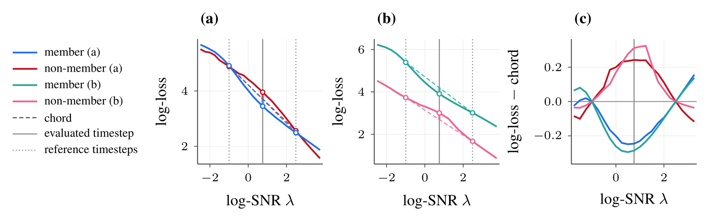
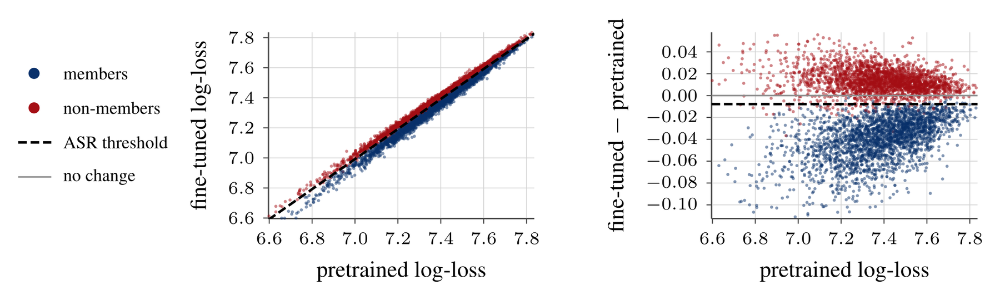

# Difficulty Calibration Across Time for Membership Inference in Diffusion Models

[**Paper (arXiv)**](https://arxiv.org/abs/2610.40616) | Official code: both
attacks, and training recipes for every model they are evaluated on.

Membership inference for diffusion models asks whether an image was in a model's
training set. The standard score is the image's reconstruction loss, but some
images are simply easier to reconstruct than others, so an easy unseen image
can score a lower loss than a difficult training image. We calibrate each
image's loss against an image-specific reference along two axes of time:
diffusion time, with Temporal Self-Calibration (TSC), and training time, with
Reference-Model Calibration (RMC). Both scores are differences of log-losses,
which cancel a per-image difficulty factor. Lower scores indicate members.

## Temporal Self-Calibration (TSC)

<p align="center">
  
</p>

TSC needs only the audited model. Image difficulty shifts an image's whole
log-loss trajectory across noise levels, while memorization appears as a
localized dip. TSC measures that dip against the chord between two context
points `Δ` away from a center log-SNR `λ*`:

`r = log L(x, λ*) − ½ [log L(x, λ*−Δ) + log L(x, λ*+Δ)]`

In (a), absolute loss identifies the member. In (b) the member is harder, so
absolute loss fails, but the dip is still visible. Subtracting the chord (c)
removes the difficulty offset and separates members from non-members in both
pairs. The defaults are `Δ = 2.5` and 5 noise draws per point, or 15 model
queries per image.

## Reference-Model Calibration (RMC)

<table>
<tr>
<td width="62%"></td>
<td>

| MS-COCO | AUC | ASR | TPR@1%FPR |
| --- | ---: | ---: | ---: |
| CLiD (q=15) | 95.55 | 88.72 | 44.04 |
| RMC (q=2) | 99.88 | 98.52 | 96.60 |
| RMC (q=20) | **99.94** | **99.04** | **98.52** |

</td>
</tr>
</table>

When the pretrained checkpoint of a fine-tuned model is available, it gives a
direct estimate of each image's difficulty. RMC subtracts its log-loss, at
the same noise level and noise, from the fine-tuned model's:

`r = log L_ft(x, λ) − log L_pre(x, λ)`

On Stable Diffusion fine-tuned on MS-COCO, the two log-losses are almost
perfectly correlated (left, Pearson r = 0.989). In their difference (right),
members fall below zero while non-members stay near it. Without
captions, at `λ = 1` with one noise draw, RMC needs 2 queries and outperforms
CLiD, which uses 15 queries and the ground-truth captions. Here `q` is the
number of model queries per image.

## Results

TSC against existing attacks on DDPMs, in percentages.

<table>
<tr><th rowspan="2">Method</th><th colspan="3">CIFAR-10</th><th colspan="3">Tiny ImageNet</th><th colspan="3">STL-10-U</th></tr>
<tr><th>AUC</th><th>ASR</th><th>TPR@1%FPR</th><th>AUC</th><th>ASR</th><th>TPR@1%FPR</th><th>AUC</th><th>ASR</th><th>TPR@1%FPR</th></tr>
<tr><td>Naive (q=20)</td><td>85.39</td><td>78.21</td><td>7.35</td><td>64.37</td><td>60.52</td><td>2.93</td><td>64.15</td><td>60.50</td><td>2.51</td></tr>
<tr><td>SecMI (q=12)</td><td>88.24</td><td>80.91</td><td>10.20</td><td>66.37</td><td>61.88</td><td>2.91</td><td>68.12</td><td>63.33</td><td>3.03</td></tr>
<tr><td>PIA (q=2)</td><td>91.90</td><td>84.88</td><td>25.80</td><td>68.99</td><td>64.25</td><td>4.43</td><td>69.46</td><td>64.51</td><td>4.08</td></tr>
<tr><td>PIAN (q=2)</td><td>89.26</td><td>83.32</td><td>30.90</td><td>67.04</td><td>63.44</td><td>6.10</td><td>66.72</td><td>63.36</td><td>4.32</td></tr>
<tr><td><b>TSC (q=15)</b></td><td><b>95.91</b></td><td><b>90.15</b></td><td><b>62.31</b></td><td><b>78.63</b></td><td><b>72.18</b></td><td><b>12.27</b></td><td><b>77.84</b></td><td><b>71.29</b></td><td><b>9.57</b></td></tr>
</table>

TSC also works across model parameterizations. The table gives TPR@1%FPR on
nine CIFAR-100 flow-matching models without augmentation, one for each pair of
prediction target and training loss. TSC is best in every configuration, by
23.84 points over the strongest baseline on average. Where membership shows up
along the trajectory depends on the training loss: as for the loss-based
baselines, the best center moves from `λ* = −0.5` (`x`-loss) to `0.5`
(`v`-loss) and `1.75` (`ε`-loss).

<table>
<tr><th rowspan="2">Method</th><th colspan="3"><i>x</i>-loss</th><th colspan="3"><i>v</i>-loss</th><th colspan="3"><i>ε</i>-loss</th></tr>
<tr><th><i>x</i>-pred</th><th><i>v</i>-pred</th><th><i>ε</i>-pred</th><th><i>x</i>-pred</th><th><i>v</i>-pred</th><th><i>ε</i>-pred</th><th><i>x</i>-pred</th><th><i>v</i>-pred</th><th><i>ε</i>-pred</th></tr>
<tr><td>Naive (q=20)</td><td>6.48</td><td>6.05</td><td>6.74</td><td>34.54</td><td>34.28</td><td>34.56</td><td>27.52</td><td>29.78</td><td>28.29</td></tr>
<tr><td>PIA (q=2)</td><td>2.27</td><td>4.07</td><td>6.22</td><td>1.01</td><td>52.48</td><td>54.84</td><td>31.69</td><td>74.61</td><td>75.85</td></tr>
<tr><td>PIAN (q=2)</td><td>2.41</td><td>6.00</td><td>5.69</td><td>1.06</td><td>56.68</td><td>58.36</td><td>72.11</td><td>77.77</td><td>76.73</td></tr>
<tr><td>SecMI (q=12)</td><td>0.94</td><td>1.10</td><td>1.19</td><td>5.55</td><td>5.57</td><td>5.26</td><td>29.25</td><td>35.40</td><td>30.82</td></tr>
<tr><td><b>TSC (q=15)</b></td><td><b>30.28</b></td><td><b>28.74</b></td><td><b>31.26</b></td><td><b>81.31</b></td><td><b>80.56</b></td><td><b>80.68</b></td><td><b>91.22</b></td><td><b>93.22</b></td><td><b>92.75</b></td></tr>
</table>

The paper also reports TSC on the Stable Diffusion fine-tunes, along with
ablations and further settings.

## Quick start

```text
training/   data download, recipes, and launchers for DDPM, EDM, and SD1.4
attacks/    TSC and RMC: python -m attacks
```

| Family | Models | Datasets |
| --- | --- | --- |
| DDPM | pytorch-ddpm UNet with `ε`-prediction, unconditional or class conditional with a linear or cosine schedule | CIFAR-10, CIFAR-100, STL10 (unlabeled), Tiny ImageNet |
| EDM flow matching | DDPM++ (SongUNet) linear flow matching with all nine `x`/`v`/`ε` prediction and loss pairs, with or without augmentation, and class conditional with label dropout | CIFAR-100 |
| Stable Diffusion v1.4 | Fine-tuned UNet, overfitting and real-world settings | Pokémon, MS-COCO, Flickr30k |

Each model is trained on one half of a fixed membership split, and the other
half is its held-out set. Attack settings are selected on first-half (shadow)
models and reported on second-half (target) models. Run everything from the
repository root.

**Install** one environment per family, with a PyTorch build for your GPU:

```bash
python -m pip install -r training/ddpm/requirements.txt   # DDPM
python -m pip install -r training/edm/requirements.txt    # EDM flow matching
python -m pip install -r training/sd14/requirements.txt   # Stable Diffusion 1.4
```

**Download data** into `data/`, where training and attacks look by default.
For example, CIFAR-10 and MS-COCO (accept its terms on Hugging Face first):

```bash
python -c "from torchvision import datasets; datasets.CIFAR10('data/ddpm/cifar10', download=True)"
huggingface-cli login && python training/sd14/prepare_data.py --dataset coco
```

The [training guide](training/README.md#data) downloads every dataset.

**Train** a target model:

```bash
python training/launch.py ddpm --config cifar10 --half second
python training/launch.py edm --config uncond_aug --half second --prediction v --loss-target v
python training/launch.py sd14 --config coco_real --half second
```

**Attack** it with the paper's default settings, which prints AUC, ASR, and
TPR@1%FPR:

```bash
# TSC on the DDPM and the flow-matching model
python -m attacks tsc --family ddpm --config cifar10 --half second \
  --checkpoint artifacts/training/ddpm/cifar10/second/ckpt-step800000.pt
python -m attacks tsc --family edm --half second \
  --checkpoint artifacts/training/edm/uncond_aug/second/pred-v_loss-v/weights-epoch-004000.pt

# RMC on the Stable Diffusion fine-tune, against the base SD v1.4
python -m attacks rmc --family sd14 --config coco_real --half second \
  --checkpoint artifacts/training/sd14/coco_real/second/milestone-checkpoint-50000
```

The [training guide](training/README.md) lists every recipe and its options.
The [attack guide](attacks/README.md) covers other models and datasets,
choosing query points, sweeps, and saving per-image scores.

## License

Code written for this repository is released under the [MIT License](LICENSE).
The trainers build on SecMI and pytorch-ddpm (DDPM), NVIDIA's EDM (flow
matching), and CLiD's Diffusers fine-tuning script (SD1.4). Each keeps its
license: MIT and WTFPL, CC BY-NC-SA 4.0, and Apache 2.0, respectively. See
[THIRD_PARTY.md](THIRD_PARTY.md) for sources, changes, and citations.
